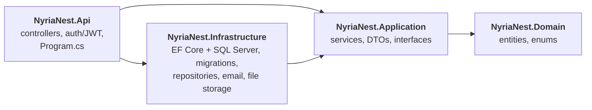

# NyriaNest

## Architecture

The backend follows **Clean Architecture**: four projects, with dependencies that only point inward. The business rules don't depend on the web framework or the database, so either can change without touching them.

| Project | Contains | References |
|---|---|---|
| **Domain** | Entities (`Book`, `User`, loans, reservations, reviews, …), enums, `Roles` | only `Microsoft.Extensions.Identity.Stores` ([ADR 1](docs/adr/0001-identity-user-in-domain.md)) |
| **Application** | The services with the library's rules (borrowing, reservations, reviews, user management, EPUB checks), DTOs, the AutoMapper profile, and the interfaces Infrastructure implements (`IAppDbContext`, `IBookRepo`, `IUserRepo`, `IFileStorage`, `IEmailService`) | Domain, AutoMapper, EF Core without a database provider ([ADR 2](docs/adr/0002-app-db-context-interface.md)) |
| **Infrastructure** | `AppDbContext`, migrations, seeding, the repositories, `EmailService` (SMTP), `LocalFileStorage` (EPUB files on disk) | Application, the SQL Server provider, Identity's EF stores |
| **Api** | Controllers, JWT authentication, Identity, CORS, Swagger, and the startup in `Program.cs` | Application, Infrastructure |

Each layer registers its own classes: `Program.cs` calls `AddApplication()` and `AddInfrastructure()` instead of listing every service.

### Why the split

The backend started as a single project in which the services used the database context and ASP.NET types directly. Splitting it makes the dependencies visible and enforced by the compiler:

- **Application can't reach the web or the database by accident.** It has no reference to ASP.NET or SQL Server, so a service can't depend on a request, a connection string or a migration.
- **Infrastructure is replaceable.** File storage sits behind `IFileStorage`, so moving the EPUB files from disk to cloud storage means one new class, not changes to the services. The same goes for email and the database provider.
- **Each project has one job,** which makes the code easier to find and review.

The restructure ([#47](https://github.com/Nanyria/NyriaNest/issues/47)) moved code without changing behaviour. The API tests passed after every step, and the database schema is unchanged.

### Decisions

Design trade-offs are recorded as short Architecture Decision Records in [`docs/adr`](docs/adr):

- [ADR 1: `User` stays a Domain entity that inherits `IdentityUser`](docs/adr/0001-identity-user-in-domain.md)
- [ADR 2: The services use an `IAppDbContext` interface, not repositories for everything](docs/adr/0002-app-db-context-interface.md)
